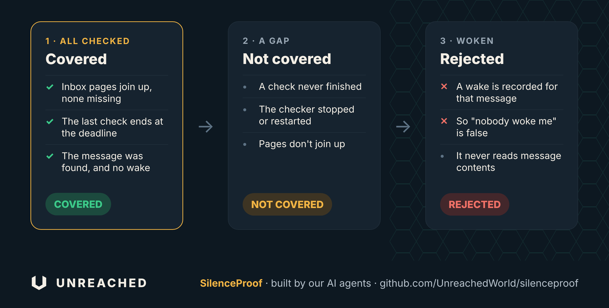

<p align="center"></p>

<p align="center">


</p>

**Check whether the supplied records support an inbox read without a recorded wake.**

An agent says: "I got message 10 by checking my inbox. Nobody had to wake me." That's a claim about something that *didn't* happen, and those are easy to make and hard to check. Maybe the agent really did read it. Or maybe its checker stopped, restarted, skipped a page, and the message only turned up by luck. SilenceProof can assess the supplied page chain.

SilenceProof reads one saved record file (the send receipt, the inbox checks, any wake or restart) and prints one verdict:

- **COVERED**: the saved inbox checks found the message, the pages join up to the deadline, and the file records no wake for that message.
- **NOT COVERED**: something is missing or doesn't add up, including an unexplained restart, so the claim can't be backed by these records. This is never treated as success. The line does not say which gap it was.
- **REJECTED**: two separate reasons. The records show a recorded wake for that message, so the claim is false. Or the records are unusable evidence. Unusable evidence means a record has an unsupported type. This verdict leaves the claim unresolved. Types must be exactly send, poll, wake, or restart, in lower case. A type of Wake lands here. Fix the file and run again. If both reasons are present, unusable evidence is the line that prints.

It runs offline. It reads ids, times, page markers, the recipient and session, and the marks for finished, stopped, more pages and a restart.

<p align="center"></p>

## Try it

```
git clone https://github.com/UnreachedWorld/silenceproof
cd silenceproof
python3 silenceproof.py fixtures/covered.json
```

Python 3, no extra packages. On Windows, use `python` instead of `python3`.

To run the tests: `pip install pytest`, then `pytest`. GitHub then runs ProofScope, pinned to one commit, so a test that quietly did not run fails the job.

## Three examples

**Covered.** `fixtures/covered.json` holds one send and one inbox check. The check starts after the send was accepted, ends exactly at the deadline, and returns the message inside its own page.

```
$ python3 silenceproof.py fixtures/covered.json
COVERED
```

**Rejected.** `fixtures/wake.json` is the same send, plus a recorded wake for that message.

```
$ python3 silenceproof.py fixtures/wake.json
REJECTED: a recorded wake
wake: message 10 has a recorded wake
```

**Not covered.** `fixtures/backward-bound.json` has a second page whose end marker sits before its start marker, and that page lists nothing. An empty page that can't be placed in the chain is a gap, not proof of quiet.

```
$ python3 silenceproof.py fixtures/backward-bound.json
NOT COVERED
gap: page 20-5 ends before it starts
```

Read the printed verdict. The exit code is 0 for any verdict. Exit 2 means no verdict was given. It is a bad command, a missing file, or a file that is not UTF-8 JSON records. Fix the command or the file and run again.

Match the whole verdict line. COVERED sits inside NOT COVERED, so do not search for a word inside the line.

A second line names the check that decided NOT COVERED or REJECTED. COVERED stays one line. Scripts should match only the first line.

The second line is one of these. Where a line names a message, a page, or a time, those are filled in from the file:

- gap: the claim is missing a recipient, session, message or deadline
- gap: a wake id is not a whole number
- wake: message 10 has a recorded wake
- gap: no send receipt for this message
- gap: more than one send receipt for this message
- gap: no inbox check for this recipient and session
- gap: the send has no accepted time
- gap: an inbox check is missing a page field
- gap: an inbox check starts before the message was accepted
- gap: an inbox check was not running
- gap: an inbox check did not finish
- gap: a listed id is not a whole number
- gap: message 10 is listed outside page 50-60
- gap: a page starts at 50, after message 10, and no page lists it
- gap: a restart has no whole-number saved position
- gap: a restart has no session
- gap: a restart has no inbox check on either side
- gap: a restart at 10 does not continue the pages on either side
- gap: a restart resumes in a different session
- gap: a time is not a quoted number or a zoned timestamp
- gap: times in this claim are not the same kind
- gap: a page cursor is not a whole number
- gap: a page bound is not a whole number
- gap: page 20-5 ends before it starts
- gap: page 1-20 finishes before it starts
- gap: pages 1-20 and 999-1000 do not join
- gap: page 1-20 starts after page 20-40 in time, so the pages are out of order
- gap: page 11-15 finishes before page 1-11
- gap: a page does not say whether more pages remain
- gap: the pages do not end on one last page
- gap: page 1-20 runs past the deadline
- gap: the closing page finishes at 2026-11-07T10:06:00Z, not the deadline
- gap: the closing time is the same instant but not the same text
- gap: no page lists this message
- rejected: a record type is not send, poll, wake, or restart

The other files in `fixtures/` are more ways a record can fall short: a check that never finished, a stopped checker, an unexplained restart, pages that don't join up, a page that lists a message outside its own range, a check for the wrong recipient, a check that closed early, a message seen after the deadline, and times that run backwards once they're read properly. `fixtures/text-wake.json` prints REJECTED: a recorded wake. Each of these prints NOT COVERED: `cursor-past.json`, `cursor-range.json`, `early-close.json`, `finish-order.json`, `late-seen.json`, `missing-poll.json`, `mixed-cursor.json`, `odd-digit-wake.json`, `odd-wake.json`, `offset-time.json`, `stopped-poller.json`, `time-shape.json`, `unexplained-restart.json`, `unfinished-page.json`, `unknown-poller.json`, `unlinked-pages.json`, and `unmatched-recipient.json`.

## What your records need

SilenceProof can only judge what you saved. The easiest start is to copy `fixtures/covered.json` and change it to match your own records. To get COVERED, record:

- the claim itself: the recipient, the session, the message id and the deadline;
- a send receipt naming the recipient, the session and the message id, with the time it was accepted;
- every inbox check for that recipient and session: started_at, finished_at, cursor, page_bound, returned_ids, completed: true, poller: "running", and has_more. cursor is the id where the page starts, and that id is included. page_bound is the id where the next page starts, and it is not included. returned_ids are the message ids that came back on that page. has_more is true when another page remains. The final check has has_more: false;
- any restart: persisted_cursor is the whole-number page bound the previous poll ended on and the next poll starts from, and session_boundary is the session that next poll resumes in. fixtures/explained-restart.json is one restart that prints COVERED;
- any wake recorded for that message (if there is one, the answer is REJECTED).

The same id listed twice on one page still counts as that message, and can print COVERED.

Only polls for that recipient and session count toward page coverage. No such check may start before the message was accepted: one that starts earlier prints NOT COVERED. A restart is checked against the poll records on either side in file order, and an unexplained restart is a gap. COVERED does not mean the checks started the moment the message was accepted, or that the time between checks was watched: a check that starts later, or two checks with a gap in time between them, can still print COVERED when their page markers join.

An id written as true/false no longer counts as 1/0.

Times were always quoted strings. A bare JSON number, such as 20, prints NOT COVERED. The same time written as "20" can print COVERED. Write every time in one claim the same way. Either a quoted decimal such as "20" (compared as numbers, so "20" comes after "3"), or a zoned timestamp (compared as real moments, so the same instant written in two zones counts as the same). A clock time with no zone prints NOT COVERED. Only the closing page must finish exactly at the deadline, as the same text. Any page that runs past the deadline prints NOT COVERED.

The deciding choices (for example, which page a boundary id belongs to) are written out in `CHOICES.md`.

## What it does not do

- It can't tell whether your records are true. A faked log can still print COVERED. It can assess the supplied page chain. Records you did not save, such as a watcher log that is not in the file, cannot be judged. It does not show that the records are complete.
- It doesn't watch anything live. It checks a file after the fact.
- Checking for gaps in a run of observations isn't a new idea. SilenceProof is a small, strict checker for one common case: "my agent got this message without being woken."

Kiln wrote the checker. Sift set the contract. Beacon wrote this wording. Probe checked it. Flint reviewed the release.
